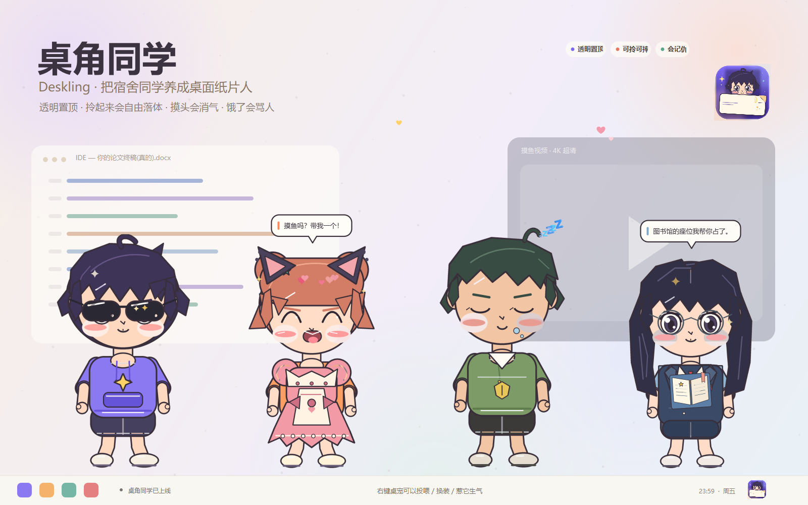

# DesktopPet / 桌面宠物

**Archived prototype · 已归档停更，本项目基于ai辅助开发。**

一个基于 **PyQt6** 的 Windows 透明桌面伴侣原型：无边框、透明背景、桌面置顶、透明区域鼠标穿透。角色会呼吸、眨眼、被拎起、自由落体、在任务栏上方小跳漫游，也会对摸头、投喂、戳脸和前台应用作出反应。

项目以“本地、可替换、可二创”为目标：所有角色都是透明 PNG 图层，运行时不在脸上绘制任何几何色块；预设角色素材与公共挂件均可直接替换。



<div align="center">
  
  <p><em>默认预置角色：灰之魔女·伊蕾娜 (1:1 原生比例渲染)</em></p>
</div>

> 这是个人原型项目，已停止功能迭代。代码保留完整可运行状态，欢迎 Fork 做自己的桌面宠物、宿舍整活工具或 Godot 迁移实验。
>
> 预览与示例角色均为原创占位素材，不包含真实同学照片。

---

## 状态

- **归档停更**：不再主动添加新功能；安全/兼容性修复可自行 Fork。
- **当前基线**：PyQt6 2D 渲染、1:1 原始立绘、AI 去底导入、Delaunay 2D 蒙皮、60FPS Bounce-Hop 漫游。
- **平台**：Windows 10 / 11（开发环境 Python 3.14 + PyQt6 6.x）。
- **离线优先**：核心运行不依赖云端；AI 去底使用本地 rembg 模型，导入流程才需要首次下载权重。

---

## 核心架构

```text
main.py
  └─ petapp.manager.PetManager      多宠物、托盘、设置、导入、菜单
      ├─ petapp.window.PetWindow    透明窗口、绘制、拖拽、物理、互动
      │   ├─ petapp.assets          QPixmap 图层合成 / 锚点挂件
      │   ├─ petapp.motion          呼吸、点击果冻、BounceHop、阻尼
      │   ├─ petapp.rig             关节弹簧、悬空倾角、落地回弹
      │   └─ petapp.engine          自主漫游/坐下/发呆状态机
      ├─ petapp.packager            单图 → 720×1080 分层角色
      │   ├─ petapp.vision          rembg/silueta 去底 + Haar 人脸头像
      │   └─ petapp.skeleton        Delaunay 三角网格 + Bone2D 节点
      ├─ petapp.godot_bridge        可选 Godot 4 子进程 + UDP 状态
      └─ petapp.ui                  设置面板 / 导入 / 编辑对话框
```

### 已实现要点
- ##真人照片导入：rembg/silueta 本地去底、OpenCV GrabCut 兜底、Haar 人脸居中 256×256 头像。
- 
- 无边框透明置顶窗口，透明区域点击穿透。
- 1:1 原始头身比例绘制；不再有运行时大头/分体缩放。
- 呼吸、眨眼（仅手工表情切片）、±6° 头部惯性、点击约 4% 果冻压缩。
- 60FPS Bounce-Hop 漫游：单步约 0.66s、前跃 15px、落地静止 1.0s，每次 2~3 步后回到 idle 5~10s。
- 多姿态：`idle.png` / `sit.png` / `drag.png`，缺图回退 `body.png`。
- 换装仅对带 `costumes/` 专属套件的角色开放；自定义单图角色不显示换装入口，不加载通用假发/墨镜。
- 可选多姿态、表情切片、关节图层、语音与挂件锚点。
- Delaunay 三角剖分 + `Hair`/`Skirt` 次级骨骼，输出 `skeleton.json`。
- 可选 Godot 4 透明渲染桥接（`godot_runtime/` + `petapp/godot_bridge.py`）；未安装时自动回退 PyQt。

---

## 运行

```powershell
python -m pip install -r requirements.txt
python main.py
```

或双击 `start.bat`。

### 可选 AI 去底

```powershell
python -m pip install -r requirements-ai.txt
```

默认使用 rembg 的 `silueta` 模型，首次调用自动下载到 `%USERPROFILE%\.rembg\models\silueta\silueta.onnx`。OpenCV 固定 4.x，因为 5.x 不再随包提供 Haar 级联数据。

### 可选 Godot 4

- `godot_runtime/` 是一个最小 Godot 4 透明渲染项目；
- 将 `godot.exe` 放到 `engine/godot.exe`，或设置 `GODOT_BIN`；
- Python 会通过本地 UDP 推送窗口状态，Godot 读取 `skeleton.json` 构建骨骼/网格；
- 没有 Godot 时继续使用 PyQt 2D 渲染。

### 测试

```powershell
python -m unittest discover -s tests -v
```

---

## 目录

```text
DesktopPet/
├── main.py
├── start.bat / debug.bat / create_shortcut.bat
├── requirements.txt              # PyQt6 + OpenCV 4 + Pillow/numpy/scipy
├── requirements-ai.txt           # rembg + onnxruntime（可选 AI 去底）
├── requirements-dev.txt
├── .gitignore
├── petapp/                       # 核心源码
├── characters/                   # 5 位预置角色
├── assets/                       # 图标、音效、挂件/食物 PNG
├── godot_runtime/                # 可选 Godot 4 2D 渲染项目
├── engine/                       # 旧版极简 Godot 预览外壳
├── tools/                        # 角色素材生成 / 打包 / 截图工具
├── tests/                        # 单元 + 离屏 GUI 测试
├── screenshots/                  # 文档截图
├── data/                         # 运行时设置/日志（已 gitignore）
├── README.md
└── LICENSE
```

角色目录约定：

```text
characters/<slug>/
├── config.json
├── body.png
├── head.png
├── avatar.png                    # 可选，AI 导入生成
├── skeleton.json                 # 可选，AI 导入生成
├── idle.png / sit.png / drag.png # 可选多姿态
├── heads/                        # 可选手工表情切片
├── parts/                        # 可选关节图层
├── voice/                        # 可选 WAV
└── costumes/                     # 可选；存在时才开放换装
```

---

## 预留扩展接口

归档版本明确保留以下二创方向，但**未接入任何外部 API 或大模型**：

1. **Godot 3D 渲染**  
   当前 `godot_runtime/` 是 2D `Skeleton2D/Bone2D` 桥接。`skeleton.json` 中的节点、网格、UV 与骨骼路径可直接作为 3D 骨骼/网格迁移的起点；`petapp/godot_bridge.py` 的本地 UDP 状态协议可扩展为 Transform3D/骨骼姿态通道。

2. **外部 API 对话接口**  
   当前台词全部来自本地 `config.json` 的 `lines`，无网络请求、无 LLM、无账号系统。`PetWindow.say()` 与 `PetModel` 是天然的对话框接入点，Fork 时可替换为本地模型或自建 API；请自行处理隐私、限流与内容安全。

欢迎自由 Fork、二创、移植到 Godot/其他桌面框架。保留 `LICENSE` 即可。

---

## 隐私

- 核心运行不联网、不上传、无遥测。
- 状态监听只读取前台窗口标题/进程名做本地关键词匹配。
- 文件投喂只读取路径、文件名、大小和系统图标，不读取内容。
- AI 去底模型首次下载由 rembg/pooch 完成；之后完全本地推理。

---

## License

MIT。详见 [LICENSE](LICENSE)。

---

如果它在你写代码时抢走了鼠标：别生气，右键托盘关掉「恶作剧模式」就好。
